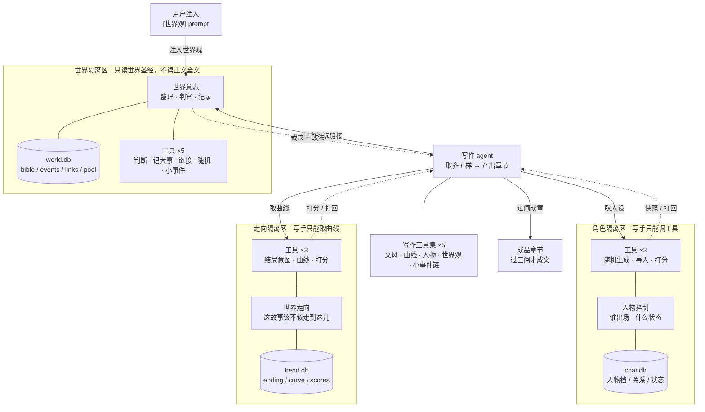

# novel-mas · 多智能体写小说

用 **三个裁判 + 一个写手** 的编排来写长篇小说，并留一条单智能体（SAS）对照组用于比较。

> 状态：**骨架阶段**。接口已定，实现等 demo。
> 建立：2026-11-17

---

## 它是什么

```
用户注入 [世界观]
      │
      ▼
┌───────────── 世界隔离区 ─────────────┐
│  世界意志 ──▶ world.db              │
│  工具 ×5：判断 / 记大事 / 链接 / 随机 / 小事件 │
└──────────────────────────────────────┘
      ▲ 提交候选链接
      │
┌───────────── 角色隔离区 ─────────────┐        ┌──────── 走向隔离区 ────────┐
│  人物控制 ──▶ char.db               │        │  世界走向 ──▶ trend.db      │
│  工具 ×3：随机生成 / 导入 / 打分      │        │  工具 ×3：结局意图 / 曲线 / 打分 │
└──────────────────────────────────────┘        └────────────────────────────┘
      ▲ 取人设（只读快照）                          ▲ 取曲线（只读）
      │                                            │
      └──────────────► 写作 agent ◄─────────────────┘
                          │ 工具 ×5：文风 / 曲线 / 人物 / 世界观 / 小事件链
                          ▼
                       成品章节
```

## 三条硬规矩

1. **三个裁判各自独占自己的库**，只有它自己能写；写手只读。
2. **所有跨角色交互都走工具**，没有 agent 之间的自由对话。
3. **写手能改的只有正文**。想动设定、人设、走向，都得走单向工具去求。

隔离靠代码落地，不靠自觉：见 `src/novel_mas/tools/registry.py` 里的工具白名单。

## 目录

| 路径 | 内容 |
|---|---|
| `docs/` | 各个 agent 的接口定义 |
| `schemas/` | 三个库的建表 SQL |
| `src/novel_mas/agents/` | 四个 agent |
| `src/novel_mas/tools/` | 工具注册表 + 权限控制 + 校验守卫 |
| `src/novel_mas/db/` | SQLite 连接与建库 |
| `tests/` | 冒烟测试 |

## 跑起来

### 最小闭环（能出结果，不花钱）

```powershell
cd E:\novel-mas
$env:PYTHONPATH = 'E:\novel-mas\src'
$env:PYTHONIOENCODING = 'utf-8'
python -m novel_mas.orchestrator
```

它会真的走完七步：注入世界观 → 定人设 → 设曲线 → 写一章 → 过闸 → 打分 → 落盘。

输出长这样：

```
[1] 世界观入库：3 条
[2] 人物入库：李三
[3] 曲线入库：第1章 50 / 第2章 60 / 第3章 75

[4] 写第 1 章（正常）
第 1 章 · PASS
  走向分 40 / 目标 50（偏差 -10）
  落盘：E:\novel-mas\data\out\ch01.txt

[5] 写第 2 章（故意踩硬约束）
第 2 章 · VIOLATED
  证据：违反硬约束「李三不能死」：正文出现了『死』
  是否写出了成文文件：没有（被拦下）
```

模型是 `FakeProvider`（`src/novel_mas/llm.py`）——**不联网、结果固定**。所以：

- ✅ 链路是真的（真读库、真写库、真拦）
- ❌ 正文是占位文本，不是作品
- ❌ 打分是词频估计，只能证明"分数能算出来"，证明不了"分数准"

接真模型只需实现 `Provider` 协议（`complete()` + `tokens_used`），编排那七步一行不用改。

### 其他

```bash
python -m pytest tests/ -q          # 冒烟测试（需先装 pytest）
python -m novel_mas.db.migrate      # 只建三个库到 data/
python examples/walkthrough.py      # 逐层讲解 types / 工具 / registry（零依赖）
```

注意：Windows PowerShell 下跑 Python，**一定要设 `PYTHONIOENCODING=utf-8`**，否则中文输出会乱码甚至崩。

## 架构图



三条硬规矩看图就明白：

1. 三个虚线框各自独立，**写手在框外**
2. 写手到三个框的线，全是走工具集的
3. 跨框没有一条 agent→agent 的直连

> 可交互版本（带 trace 动效与导出）：`<workspace>\.archify\architecture-mas-story-v9-20261117-1910\mas-story-v9.html`
>
> 设计与决策记录：`E:\dsh-data\novel-mas\编排日志.md`
