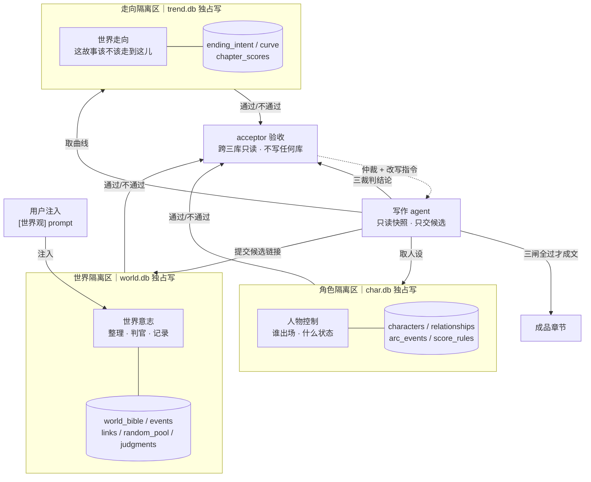

# novel-mas

> A minimal multi-agent writing experiment: three judges, one writer,
> and a database boundary enforced in code.
>
> 三个裁判各守一个库，写手只交正文；隔离由代码强制。
>
> 纯标准库 · 零第三方依赖 · Python ≥ 3.11 · MIT
> 建立 2026-11-17，最后更新 2026-11-18

---

## 概述

写手只能写正文。世界观、人物、走向三个裁判各自独占一个 SQLite 库，只有它自己能写；
写手只能读快照、只能提交候选。三裁判全过才落盘；不通过时，由第四个角色
（跨三库只读的验收 agent）仲裁，给出可执行的改写指令后重写。

本项目是实验代码，不是产品，也不是通用框架。目标是可运行、可测试、可复现。

## 研究问题

1. 角色隔离能否由代码强制，而不是依赖提示词约束
2. 多裁判链路能否实际降低硬伤数量
3. 为此需要付出多少 token 成本

三个问题各对应一节实验记录，数据见 [`EXPERIMENTS.md`](EXPERIMENTS.md)。

## 判定链

```
正文草稿
   │
   ├─ 三裁判并行：世界意志 / 人物控制 / 世界走向
   │
   ├─ 全部通过 ────────────────────────────▶ 落盘
   │
   └─ 存在不通过
        ├─ 改写次数用尽 ───────────────────▶ 拦下，不落盘
        └─ 仍有次数 → acceptor 仲裁 ────────▶ 按指令重写
                       （听取哪一方 + 如何改写，输出可执行指令）
```

为控制成本，仲裁只在两种情况下调用：三裁判全过时不调用；改写次数用尽后不再调用。

## 角色与库



## 三条硬规矩

1. 三个裁判各自独占自己的库，只有它自己能写；写手只读。
2. 所有跨角色交互都走工具，agent 之间没有自由对话。
3. 写手能改的只有正文。想动设定、人设、走向，都要走单向工具申请。

隔离由代码强制，而非依赖提示词约束：见 [`src/novel_mas/tools/registry.py`](src/novel_mas/tools/registry.py)
的工具白名单，以及 `tests/selfcheck.py` 中的四条越权断言。

## 工具清单（19 个）

| 角色 | 数 | 工具 | 可写库 |
|---|---|---|---|
| 世界意志 | 6 | `check_consistency` `record_event` `record_minor_event` `link_events` `manage_random` `inject_event` | 仅 `world.db` |
| 人物控制 | 3 | `random_character` `import_character` `score_in_character` | 仅 `char.db` |
| 世界走向 | 3 | `set_ending_intent` `set_curve` `score_direction` | 仅 `trend.db` |
| 验收 acceptor | 2 | `review_article` `arbitrate` | 不可写（跨三库只读） |
| 写作 writer | 5 | `set_style` `get_curve` `get_characters` `get_worldview` `link_minor_events` | 不可写（无任何写库工具） |

> `link_minor_events` 只产生 `pending_review` 候选，是否落盘由世界意志决定。

## 实现现状

| 能力 | 状态 | 证据 |
|---|---|---|
| 五角色 / 19 工具 / 白名单隔离 | 已实现，有测试 | `tests/selfcheck.py` 14 项 |
| 假模型七步闭环（注入→取数→生成→过闸→打分→落盘） | 已实现 | E-001 |
| 真模型生成可读正文 | 已实现 | E-002 |
| 打回后自动重写 | 已实现 | E-003 |
| 三裁判角度互补 | 已验证 | E-004 |
| 判官准确度 | 未达标（81.8%，22 条样本） | E-005 |
| 判官低温稳定 | 已修复（`llm.judge_mode()`） | E-007 |
| MAS vs SAS 三章对照 | 进行中（三章、单题材、单模型） | E-008 |
| 人物状态随章推进 | 已实现（`character_states`，P1） | selfcheck #6 |
| 文笔评价 | 未做双盲 | — |

## 部署定位（先说清楚）

这是**本机单用户工具**，不是服务器产品：

- 默认只听 `127.0.0.1`，没有登录、没有鉴权、没有限流
- 配置（含 API key）只在本机：默认写仓库根 `.env`；装到只读目录时自动落到
  `%APPDATA%\novel-mas\.env`
- `.env` 可以由界面「模型配置」直接生成/更新（`base_url` / `model` / `api_key` 一次配完），
  也可以自己手写。生成时不会留带 key 的副本
- 要放到服务器上对外提供服务，请自行加反向代理、鉴权和 TLS —— 那些不在本项目范围内

## 运行

### 0. 自检（零依赖、不联网、无 API 费用）

```powershell
# Windows PowerShell
git clone <this-repo> novel-mas
cd novel-mas
$env:PYTHONPATH = "$PWD\src"
$env:PYTHONIOENCODING = "utf-8"
python tests/selfcheck.py
```

```bash
# macOS / Linux
cd novel-mas
PYTHONPATH=src python tests/selfcheck.py
```

期望输出 `通过 14 项，失败 0 项`。该自检只校验结构：库能否建立、白名单是否遗漏、
越权是否被拒、写手是否具备写库权限、两个纯逻辑函数（查环、断崖告警）是否正确。
它不校验功能实现，也不校验判官准确度。

### 1. 七步闭环（假模型，不联网）

```powershell
$env:PYTHONPATH = "$PWD\src"
$env:PYTHONIOENCODING = "utf-8"
python -m novel_mas.orchestrator
```

该流程会实际读写三个库并执行拦截。输出示例：

```
[1] 世界观入库：3 条
[2] 人物入库：李三
[3] 曲线入库：第1章 50 / 第2章 60 / 第3章 75
[4] 写第 1 章（正常）   第 1 章 · PASS
[5] 写第 2 章（故意踩硬约束）
    第 2 章 · VIOLATED
    证据：违反硬约束「李三不能死」：正文出现了『死』
    是否写出了成文文件：没有（被拦下）
```

模型为 `FakeProvider`：链路真实（读写库、拦截均生效）；正文为占位文本；打分为词频估计。

### 2. 接入真模型（OpenAI 兼容端点）

在仓库根目录创建 `.env`：

```ini
DEEPSEEK_API_KEY=sk-...
NOVEL_BASE_URL=https://api.deepseek.com
# 可选
NOVEL_MODEL=deepseek-chat
```

实现 `Provider` 协议即可（仅需 `complete(prompt, system)` 与 `tokens_used()` 两个成员），
编排层不需要修改。判官走 `judge_mode()`（0.1），写作仍为 0.8；原因见 E-007。

### 3. 简易界面（可选）

Windows 直接双击 **`start-app.bat`**。它不弹黑框，实际逻辑在 `start-app.ps1`：

- 起 `python -m novel_mas.web`（端口已在听就不重复起，也不接管别人起的进程）
- 用**独立 profile** 开一个 Edge / Chrome 应用窗口（`--app`），关掉窗口就是真退出
- 窗口关掉后，只停它自己起的那个服务
- 全过程写进 `app.log`

手动起（macOS / Linux，或不想开独立窗口）：

```powershell
python -m novel_mas.web      # http://127.0.0.1:8787
```

### 4. 逐层讲解脚本（零依赖）

```bash
python examples/walkthrough.py      # types → 工具 → registry
```

> Windows 下运行 Python 应设置 `PYTHONIOENCODING=utf-8`，否则中文输出可能乱码或报错。

## 使用方式：换成自己的故事

`python -m novel_mas.orchestrator` 跑的是固定 demo。要写自己的书，直接用 `Orchestrator`：
三个配置方法 + 一个写章方法。

```python
from novel_mas.llm import FakeProvider
from novel_mas.orchestrator import Orchestrator

orc = Orchestrator(book_id="lamp", llm=FakeProvider(style="日常"))

orc.ingest_worldview("雨停之后，城里的灯要自己点。点灯人一生只能点一盏。")
orc.add_character("林小满", "十五岁，点灯人的学徒，怕黑，说话总是先看一眼灯", "lead")
orc.set_trend(
    points=[(1, 50, 15), (2, 65, 15)],       # (章, 目标分, 容忍带)
    ending_type="bittersweet",
    target_score=75,
    hard_constraints=["林小满不能失忆"],
)

r = orc.write_chapter(1, "林小满第一次独自去点灯，火折子在雨里湿了一半。")
print(r.brief())
```

上面的写法实际跑过，输出为：

```
第 1 章 · 过闸 PASS / 走向 on_track
  走向分 50 / 目标 50（偏差 +0）
  用掉 token 1200
  分账：character 589 / trend 310 / world_will 199 / writer 102
  证据：
    - 过闸 pass：[假模型] 没匹配到违禁词，放行
    - 人物 林小满：60 分（阈值 60，过）
  落盘：data/out/lamp-ch01.txt
```

接口一览：

| 方法 | 参数 | 作用 |
|---|---|---|
| `ingest_worldview(prompt)` | 一段世界观文字 | 按「。」「；」拆条目写进 `world_bible`；同一本书重灌是覆盖 |
| `add_character(name, profile, importance)` | `importance` 取 `lead` / `support` | 写进 `characters`，初始状态「初登场」 |
| `set_trend(points, ending_type, target_score, hard_constraints)` | `points` 为 `(章, 目标分, 容忍带)` | 写 `ending_intent` 与 `curve` |
| `write_chapter(chapter, brief, mock_text=None, max_retries=1)` | `brief` 是本章要发生什么 | 走完七步，返回 `WriteResult` |

`WriteResult` 可读字段：`verdict`（过闸 `pass` / `violated`）、`trend_verdict`（`on_track` / `drifted` / `violated`）、
`score`、`target`、`deviation`、`tokens`、`cost_by_role`（按角色分账）、`evidence`、`out_path`。

需要注意的三点：

- `book_id` 决定数据归属；同一 `book_id` 重跑会覆盖同名条目，不追加。
- 正文落盘在 `data/out/<book_id>-chNN.txt`；`book_id="demo"` 仍用 `chNN.txt`（实验记录引用过这些文件名）。
- 正常一章调用 4 次模型（写手 1 次 + 三裁判各 1 次）；被拦且还有重写预算时，多一次 acceptor 仲裁。

接真模型只需换 `llm`：`Orchestrator(book_id="lamp", llm=OpenAIProvider.from_env())`，其余代码不动。

## 实验摘要

### E-007：同一份正文（1266 字，未改动）的判官温度影响

| 温度 | 三次打分 | 极差 |
|---|---|---|
| **0.1** | 64 / 64 / 64 | **0** |
| 0.8 | 60 / 61 / 70 | 10 |
| 0.95 | 55 / 60 / 65 | 10 |

「跑章时 72 分、事后审计 55 分」的原因不是判定标准变化，而是同一配置下打分波动；
阈值 60 恰好落在波动区间内。修复方式：判官 0.1、写作 0.8。
副作用：`chapter_scores` 中的历史数据均在 0.8 下产生，不能作为基线。

### E-008：MAS vs SAS（三章，判官均为 0.1）

| | MAS | SAS |
|---|---|---|
| 总字数 | 6079 | 3949 |
| 总 token | **32123** | **3502** |
| 硬问题 | **0 条** | **2 条** |
| 软问题 | 5 条（0.82/千字） | 2 条（0.51/千字） |
| 人物过闸 | 3/3 | 2/3 |

可以得出的结论：硬伤被压到 0，代价是 9.2 倍 token（其中 86% 消耗在审查，写作占 14%）。
不能得出的结论：不能说明「写得更好」——软问题反而更多；三章、单题材、单模型，无法外推。
完整限定见 [`EXPERIMENTS.md`](EXPERIMENTS.md)。

## 已知局限

- **人物状态只推进 lead**：`character_states` 按章记录状态，写手取「不超过本章的最近一条」；
  这一层已实现（P1）。但只有被评分的 lead 人物会推进，support/minor 仍停在「初登场」。
- **篇幅靠软约束**：写手提示词里写了 2500–3000 字，实测落在 2400 上下；
  不保证进区间，也未做「越界重写」。
- **判官与写手是同一模型**：自行写作、自行判定，缺少第三方仲裁（E-005 的方法论问题）。
- **判官准确度 81.8%**，未达标，样本仅 22 条。
- **跨类冲突无检测**：三个裁判可能各自放行，但结论互相矛盾。
- **`judge_mode()` 通过临时修改共享 `llm.temperature` 实现**：单线程安全，并行调用会互相干扰。
- `book_id` 默认 `demo`，不支持多书并存。

## 目录

| 路径 | 内容 |
|---|---|
| `src/novel_mas/agents/` | 五个 agent（world_will / character / trend / writer / acceptor） |
| `src/novel_mas/tools/registry.py` | 工具白名单与权限检查，隔离落点 |
| `src/novel_mas/db/` | SQLite 连接与建库 |
| `src/novel_mas/orchestrator.py` | 七步编排、判定链、重写闭环 |
| `src/novel_mas/llm.py` | `Provider` 协议、`FakeProvider`、`judge_mode()`、token 记账 |
| `src/novel_mas/web.py` | 表单式简易界面（端口 8787） |
| `start-app.bat` / `start-app.ps1` | Windows 桌面启动器：起服务 + 开应用窗口，关窗即退 |
| `schemas/all.sql` | 三个库的建表 SQL |
| `docs/architecture.md` | 设计取舍与已知问题 |
| `docs/踩坑记录.md` | 联调与自检时踩的坑：现象、判据、根因、修法 |
| `docs/待解决问题.md` | 实测提出的问题：现状、候选方案、成本/难度、待填解决方案 |
| `tests/selfcheck.py` | 零依赖自检（CI 使用） |
| `tests/audit_chapter.py` | 单章审计：过闸与三裁判打分 |
| `tests/sas_baseline.py` | SAS 对照组 |
| `tests/calibration/` | 一致性校准集（E-005） |
| `EXPERIMENTS.md` | 实验记录：可得出与不可得出的结论 |
| `.archify/architecture-novelmas-v10-20261118-210500/novelmas-v10.html` | 可交互架构图 |

## 建议阅读顺序

1. `src/novel_mas/tools/registry.py`：隔离如何变成一条 `PermissionError`
2. `tests/selfcheck.py`：如何把隔离写成可重复执行的断言
3. `src/novel_mas/orchestrator.py` 的 `write_chapter()`：判定链、重写预算、仲裁时机
4. `EXPERIMENTS.md`：E-005 的失败结论与 E-007 的排查过程

## 许可

MIT，见 [`LICENSE`](LICENSE)。
