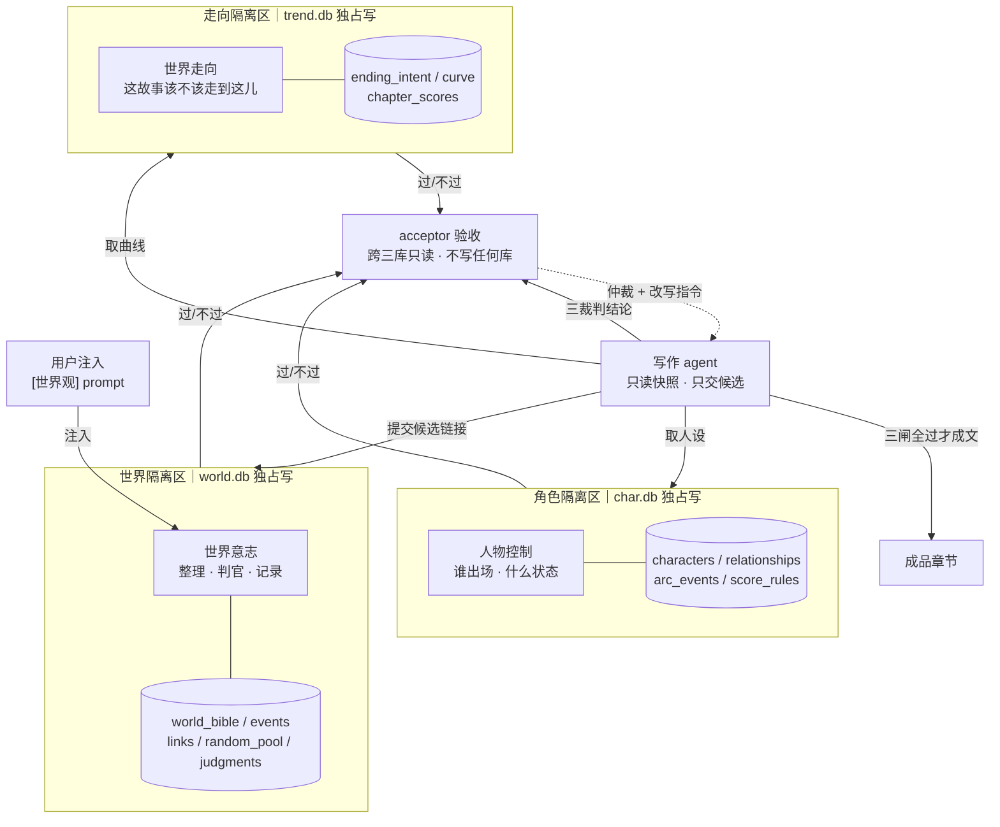

# novel-mas · 三个裁判盯着一个写手写小说

> 一个**学习用**的多智能体最小闭环：把「角色隔离」写成**代码能测**的东西，
> 再用一组对照实验看它到底值不值那个 token 钱。
>
> 纯标准库 · 零第三方依赖 · Python ≥ 3.11 · MIT
> 建立 2026-11-17，最后更新 2026-11-18

---

## 一句话

**写手只能写正文**；世界观、人物、走向三个裁判各自独占一个 SQLite 库，只有它自己能写；
写手只能读快照、只能提交候选。三裁判全过才落盘，不过就由第四个角色（跨三库只读的验收 agent）
仲裁，给可执行的改写指令，再重写。

不是产品，也不是框架 —— 是**一个能跑、能测、能复现的对照实验**。

## 这个项目想验证什么

1. **隔离能不能落在代码里**，而不是靠提示词自觉
2. **多裁判一条链，能不能真的压住硬伤**
3. **为此要多花多少 token**

三个问题各有一节实验记录，数据都在 [`EXPERIMENTS.md`](EXPERIMENTS.md)。

## 判定链

```
正文草稿
   │
   ├─ 三裁判并行：世界意志 / 人物控制 / 世界走向
   │
   ├─ 全过 ────────────────────────────────▶ 落盘
   │
   └─ 有不过
        ├─ 改写次数用尽 ───────────────────▶ 拦下，不落盘
        └─ 还有次数 → acceptor 仲裁 ────────▶ 按指令重写
                       （听谁的 + 怎么改，给成可执行的句子）
```

两个省钱的口子：**全过不调仲裁**、**改写次数用尽不调仲裁**。
仲裁不是「觉得不好就调」，而是在「打架或一致不过」时才出场。

## 三个角色区 + 一个写手 + 一个验收



## 三条硬规矩

1. **三个裁判各自独占自己的库**，只有它自己能写；写手只读。
2. **所有跨角色交互都走工具**，agent 之间没有自由对话。
3. **写手能改的只有正文**。想动设定、人设、走向，都得走单向工具去求。

隔离靠代码落地，不靠自觉 —— 见 [`src/novel_mas/tools/registry.py`](src/novel_mas/tools/registry.py)
的工具白名单，以及 `tests/selfcheck.py` 里那四条「拿不到」断言。

## 工具清单（19 个）

| 角色 | 数 | 工具 | 能写库 |
|---|---|---|---|
| 世界意志 | 6 | `check_consistency` `record_event` `record_minor_event` `link_events` `manage_random` `inject_event` | ✅ 只写 `world.db` |
| 人物控制 | 3 | `random_character` `import_character` `score_in_character` | ✅ 只写 `char.db` |
| 世界走向 | 3 | `set_ending_intent` `set_curve` `score_direction` | ✅ 只写 `trend.db` |
| 验收 acceptor | 2 | `review_article` `arbitrate` | ❌ 跨三库只读 |
| 写作 writer | 5 | `set_style` `get_curve` `get_characters` `get_worldview` `link_minor_events` | ❌ 一个写库工具都没有 |

> `link_minor_events` 只产出 `pending_review` 候选，落不落盘由世界意志点头。

## 现在到哪一步了（诚实版）

| 能力 | 状态 | 证据 |
|---|---|---|
| 五角色 / 19 工具 / 白名单隔离 | ✅ 实现，有测试 | `tests/selfcheck.py` 14 项 |
| 假模型七步闭环（注入→取数→生成→过闸→打分→落盘） | ✅ | E-001 |
| 真模型出可读正文 | ✅ | E-002 |
| 打回后自动重写 | ✅ | E-003 |
| 三裁判角度互补 | ✅ | E-004 |
| 判官判得准不准 | ❌ **81.8%，没过线**（只有 22 条样本） | E-005 |
| 判官低温稳定 | ✅ 已修（`llm.judge_mode()`） | E-007 |
| MAS vs SAS 三章对照 | ⚠️ 进行中，三章一个题材一个模型 | E-008 |
| **人物状态随章推进** | ❌ **没做** —— 见下面「已知局限」 | — |
| 文笔评价 | ❌ 没做双盲 | — |

## 跑起来

### 0. 自检（零依赖，不联网，不花钱）

```powershell
# Windows PowerShell
git clone <this-repo> novel-mas
cd novel-mas
$env:PYTHONPATH = "$PWD\src"
$env:PYTHONIOENCODING = "utf-8"
python tests/selfcheck.py
```

```bash
# macOS / Linux
cd novel-mas
PYTHONPATH=src python tests/selfcheck.py
```

期望看到 `通过 14 项，失败 0 项`。它验的是**结构**：库建得起来、白名单没漏、
该拦的拿不到工具、写手没写库权限、两条纯逻辑（查环、断崖告警）对。
**它不验功能，也不验判官准不准。**

### 1. 七步闭环（假模型，不联网）

```powershell
$env:PYTHONPATH = "$PWD\src"
$env:PYTHONIOENCODING = "utf-8"
python -m novel_mas.orchestrator
```

它会真读库、真写库、真拦人。输出长这样：

```
[1] 世界观入库：3 条
[2] 人物入库：李三
[3] 曲线入库：第1章 50 / 第2章 60 / 第3章 75
[4] 写第 1 章（正常）   第 1 章 · PASS
[5] 写第 2 章（故意踩硬约束）
    第 2 章 · VIOLATED
    证据：违反硬约束「李三不能死」：正文出现了『死』
    是否写出了成文文件：没有（被拦下）
```

模型是 `FakeProvider`：✅ 链路是真的；❌ 正文是占位文本，不是作品；❌ 打分是词频估计。

### 2. 接真模型（OpenAI 兼容端点）

在仓库根目录放一个 `.env`：

```ini
DEEPSEEK_API_KEY=sk-...
NOVEL_BASE_URL=https://api.deepseek.com
# 可选
NOVEL_MODEL=deepseek-chat
```

再实现 `Provider` 协议（只有 `complete(prompt, system)` 和 `tokens_used()` 两个成员），
编排那七步一行不用改。判官走 `judge_mode()`（0.1），写作仍 0.8 —— 为什么，见 E-007。

### 3. 小界面（可选，标准库 `http.server`）

```powershell
python -m novel_mas.web      # http://127.0.0.1:8787
```

### 4. 逐层讲解脚本（零依赖）

```bash
python examples/walkthrough.py      # types → 工具 → registry 的前三步
```

> Windows 下跑 Python 一定要设 `PYTHONIOENCODING=utf-8`，否则中文输出会乱码甚至崩。

## 实验证据（摘要）

### E-007：尺子会抖 —— 同一份正文（1266 字，一字没改）

| 温度 | 三次打分 | 极差 |
|---|---|---|
| **0.1** | 64 / 64 / 64 | **0** |
| 0.8 | 60 / 61 / 70 | 10 |
| 0.95 | 55 / 60 / 65 | 10 |

「跑章时 72 分、事后审计 55 分」不是判得不一样，是**同一把尺子在抖**；阈值 60 正好落在抖动区间。
修法：判官 0.1、写作 0.8。**副作用：`chapter_scores` 里的历史数据都是 0.8 下量的，不能当基线。**

### E-008：MAS vs SAS（三章，尺子全是 0.1）

| | MAS | SAS |
|---|---|---|
| 总字数 | 6079 | 3949 |
| 总 token | **32123** | **3502** |
| 硬问题 | **0 条** | **2 条** |
| 软问题 | 5 条（0.82/千字） | 2 条（0.51/千字） |
| 人物过闸 | 3/3 | 2/3 |

**能说的**：硬伤确实被压到 0；代价是 **9.2 倍 token**（多花的钱 86% 在审查，写作只占 14%）。
**不能说的**：不是「写得好」——软问题反而更多；三章一个题材一个模型，不能推广。
完整限定见 [`EXPERIMENTS.md`](EXPERIMENTS.md) 的「不能得出 / 必须限定」五条。

## 已知局限（改之前先读这条）

- **人物 `state` 不随章推进**：`characters` 表只有「初登场」那一条，`as_of_chapter` 恒为 0（甚至 None）。
  写手第 2 章看到的人物跟第 1 章一模一样 —— **现在能写一章，写不了一部**。这是 P1，未做。
- **判官和写手是同一个模型**：自己写、自己判，缺第三方仲裁（E-005 那条方法论问题）。
- **判官准确率 81.8%**，没过线，样本只有 22 条。
- **跨类冲突无检测**：三个裁判可能各自放行、合起来却互相矛盾。
- **`judge_mode()` 是临时改共享 `llm.temperature`**：单线程安全，将来并行调用会串。
- `book_id` 默认 `demo`，多书并存没做。

## 目录

| 路径 | 内容 |
|---|---|
| `src/novel_mas/agents/` | 五个 agent（world_will / character / trend / writer / acceptor） |
| `src/novel_mas/tools/registry.py` | 工具白名单 + 权限闸门 —— **隔离的落点** |
| `src/novel_mas/db/` | SQLite 连接与建库 |
| `src/novel_mas/orchestrator.py` | 七步编排 + 判定链 + 重写闭环 |
| `src/novel_mas/llm.py` | `Provider` 协议、`FakeProvider`、`judge_mode()`、token 记账 |
| `src/novel_mas/web.py` | 一屏表单式的小界面（端口 8787） |
| `schemas/all.sql` | 三个库的建表 SQL |
| `docs/architecture.md` | 设计取舍与已知问题 |
| `tests/selfcheck.py` | 零依赖自检（CI 跑这个） |
| `tests/audit_chapter.py` | 单章审计：过闸 + 三裁判打分 |
| `tests/sas_baseline.py` | SAS 对照组 |
| `tests/calibration/` | 一致性校准集（E-005） |
| `EXPERIMENTS.md` | 实验记录：能得出什么、不能得出什么 |
| `.archify/architecture-novelmas-v10-20261118-210500/novelmas-v10.html` | 可交互架构图 |

## 想拿它学什么

按这个顺序读，最快看懂：

1. `src/novel_mas/tools/registry.py` —— 40 行讲清「隔离怎么变成一条 `PermissionError`」
2. `tests/selfcheck.py` —— 把「隔离」写成 4 条断言，CI 每推一次跑一遍
3. `src/novel_mas/orchestrator.py` 的 `write_chapter()` —— 判定链、重写预算、仲裁时机
4. `EXPERIMENTS.md` —— 一个失败的实验（E-005）和一个「先怀疑尺子」的排查（E-007）

## 许可

MIT，见 [`LICENSE`](LICENSE)。
